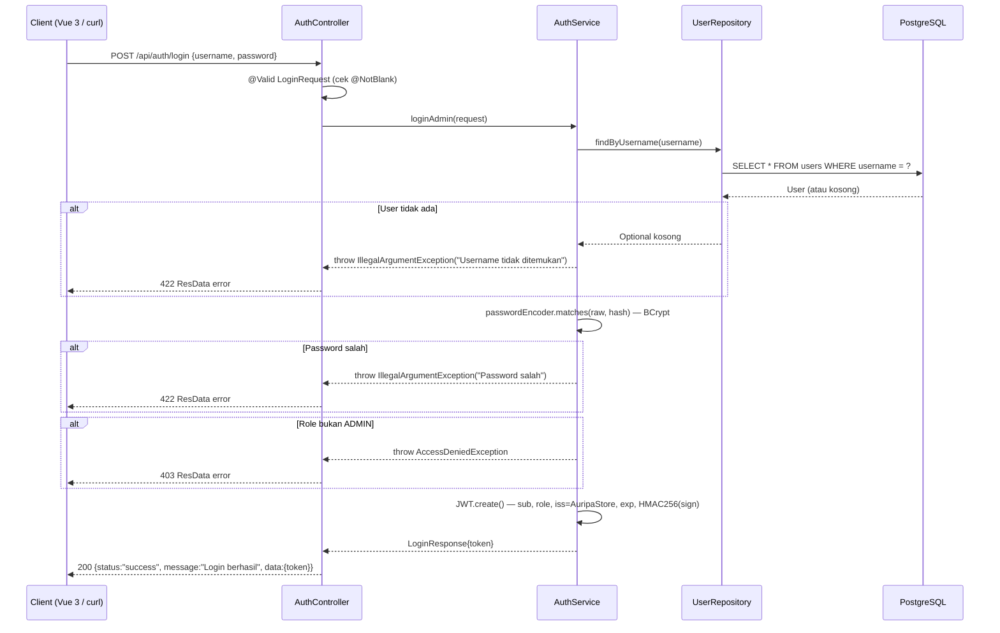
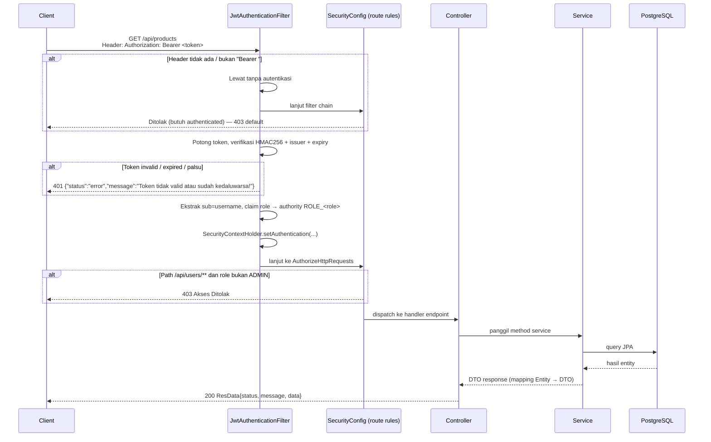
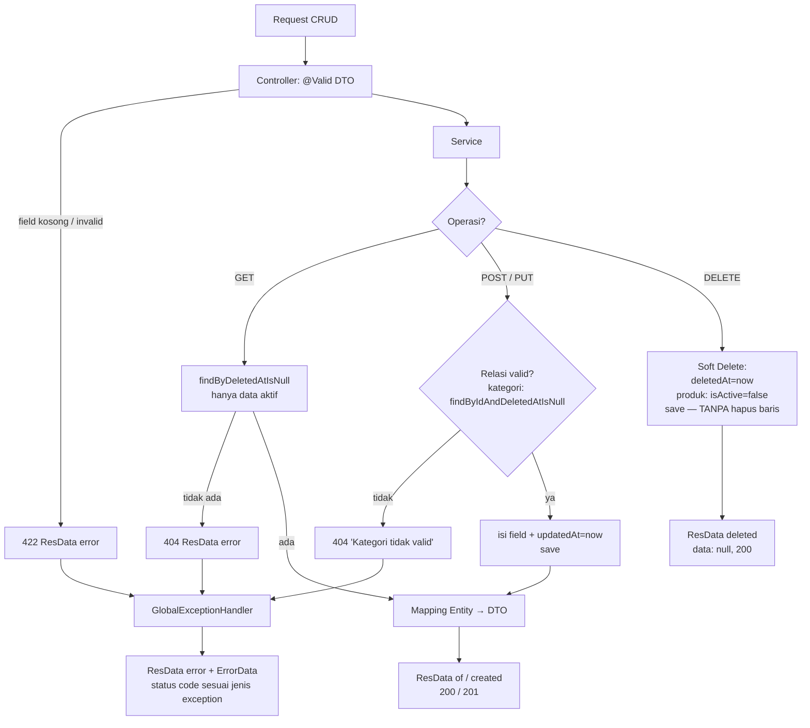

# 📚 Auripa Store — Dokumentasi Teknis (DOCUMENTATION.md)

> **Versi Dokumen:** 1.0 · **Status:** Dalam Pengembangan (MVP Backend)
> **Proyek:** Auripa Store (E-Commerce Platform) · **Lead Engineer:** Kemip (Miftah Aufar) · **Studio:** Vroxilabs
> Dokumen pendukung: [README.md](README.md) (pengenalan) · PRD internal v1.0 (kebutuhan produk)

---

## Daftar Isi

1. [Gambaran Arsitektur](#1-gambaran-arsitektur)
2. [Struktur Package & Tanggung Jawab](#2-struktur-package--tanggung-jawab)
3. [Konfigurasi & Environment](#3-konfigurasi--environment)
4. [Model Data (Entitas & Relasi)](#4-model-data-entitas--relasi)
5. [Modul Keamanan (Autentikasi & Otorisasi)](#5-modul-keamanan-autentikasi--otorisasi)
6. [Standar Respons API (ResData)](#6-standar-respons-api-resdata)
7. [Referensi API Lengkap](#7-referensi-api-lengkap)
8. [Flow / Alur Kerja Aplikasi](#8-flow--alur-kerja-aplikasi)
9. [Error Handling & Kode Status](#9-error-handling--kode-status)
10. [Validasi Data (Jakarta Validation)](#10-validasi-data-jakarta-validation)
11. [Business Rules & Catatan Penting](#11-business-rules--catatan-penting)
12. [Panduan Pengembangan & Pengujian](#12-panduan-pengembangan--pengujian)
13. [Dokumen Pendukung](#13-dokumen-pendukung)

---

## 1. Gambaran Arsitektur

Auripa Store menggunakan arsitektur **layered (bertingkat)** khas aplikasi Spring Boot dengan pemisahan ketat antara lapisan presentation, business logic, dan data access:

```
┌─────────────────────────────────────────────────────────────────┐
│                        CLIENT (Vue 3 SPA)                      │
│            Axios · Pinia · Tailwind (direncanakan)              │
└────────────────────────────┬────────────────────────────────────┘
                             │  HTTP JSON + Header: Authorization: Bearer <JWT>
┌────────────────────────────▼────────────────────────────────────┐
│  LAYER KEAMANAN (Servlet Filter Chain)                         │
│  SecurityConfig → JwtAuthenticationFilter → Route Rules        │
└────────────────────────────┬────────────────────────────────────┘
┌────────────────────────────▼────────────────────────────────────┐
│  CONTROLLER  (com.project.auripa.controller)                   │
│  Menerima request, validasi DTO (@Valid), membungkus ResData   │
├─────────────────────────────────────────────────────────────────┤
│  SERVICE  (com.project.auripa.service)                         │
│  Business rule: autentikasi, soft-delete, relasi, mapping DTO  │
├─────────────────────────────────────────────────────────────────┤
│  REPOSITORY  (com.project.auripa.repository)                   │
│  Spring Data JPA — query method (findByDeletedAtIsNull, dll.)  │
├─────────────────────────────────────────────────────────────────┤
│  ENTITY / DATABASE (PostgreSQL + HikariCP + Hibernate)         │
│  users · categories · products                                 │
└─────────────────────────────────────────────────────────────────┘

 cross-cutting:
   • GlobalExceptionHandler (@RestControllerAdvice) → error JSON standar
   • ResponseBuilder / ResponseConstant        → helper & pesan standar
```

**Prinsip alur data:** `Request → Filter (JWT) → Controller → Service → Repository → PostgreSQL`, dan kembali `Entity → DTO (Response) → ResData JSON`.

## 2. Struktur Package & Tanggung Jawab

```
com.project.auripa
├── AuripaApplication.java                  # Entry point Spring Boot
│
├── config/
│   └── SecurityConfig.java                 # Filter chain, aturan akses, BCrypt, seed akun default
├── security/
│   └── JwtAuthenticationFilter.java        # Verifikasi JWT per-request & penetapan Authentication
│
├── controller/                             # Lapisan HTTP (endpoint REST)
│   ├── AuthController.java                 # POST /api/auth/login
│   ├── UserController.java                 # /api/users/** (CRUD + /me)
│   ├── CategoryController.java             # /api/categories/** (CRUD)
│   └── ProductController.java              # /api/products/** (CRUD)
│
├── service/                                # Lapisan bisnis
│   ├── AuthService.java                    # Validasi kredensial + penerbitan JWT
│   ├── UserService.java                    # CRUD user, hash password, cek duplikasi
│   ├── CategoryService.java                # CRUD kategori + soft delete
│   └── ProductService.java                 # CRUD produk + soft delete + validasi kategori
│
├── repository/                             # Lapisan akses data (Spring Data JPA)
│   ├── UserRepository.java                 # findByUsername
│   ├── CategoryRepository.java             # findByDeletedAtIsNull, findByIdAndDeletedAtIsNull
│   └── ProductRepository.java              # findByDeletedAtIsNull, findByIdAndDeletedAtIsNull
│
├── entity/                                 # Pemetaan tabel database
│   ├── User.java                           # tabel users
│   ├── Category.java                       # tabel categories
│   └── Product.java                        # tabel products (relasi Many-to-One → Category)
│
├── dto/                                    # Kontrak request/response (anti anemic leak)
│   ├── request/
│   │   ├── login/LoginRequest.java         # { username, password }
│   │   ├── user/UserCreateRequest.java     # { username, password, role }
│   │   ├── user/UserUpdateRequest.java     # { username, role }
│   │   ├── CategoryRequest.java            # { name }
│   │   └── ProductRequest.java             # { name, description, price, categoryId, isActive }
│   ├── response/
│   │   ├── ResData.java                    # ✅ Wrapper standar { status, message, data }
│   │   ├── login/LoginResponse.java        # { token }
│   │   ├── user/UserResponse.java          # { id, username, role }
│   │   ├── CategoryResponse.java           # { id, name }
│   │   └── ProductResponse.java            # { id, name, description, price, isActive, category }
│   └── data/
│       └── ErrorData.java                  # { timestamp, status, error, message, path }
│
├── handler/
│   ├── GlobalExceptionHandler.java         # @RestControllerAdvice — semua error → JSON standar
│   └── ResourceNotFoundException.java      # Custom exception 404
│
└── util/
    ├── ResponseConstant.java               # Konstanta pesan (MSG_SUCCESS, MSG_FORBIDDEN, …)
    └── ResponseBuilder.java                # Helper ResponseEntity<ResData>
```

**Tanggung jawab per lapisan:**

| Lapisan | Boleh melakukan | Tidak boleh |
|---|---|---|
| Controller | Terima/validasi input (`@Valid`), panggil Service, bungkus `ResData` | Akses Repository langsung, logika bisnis |
| Service | Business rule, mapping Entity↔DTO, transaksi | Tentukan HTTP status/headers |
| Repository | Query ke database (derived query methods) | Logika bisnis |
| Entity | Pemetaan kolom/tabel | Logika HTTP/bisnis |

## 3. Konfigurasi & Environment

Template resmi: `src/main/resources/application.properties.example`. Salin ke `application.properties` lalu lengkapi.

| Properti | Contoh | Keterangan |
|---|---|---|
| `server.port` | `8080` | Port HTTP |
| `spring.datasource.url` | `jdbc:postgresql://localhost:5432/auripa_store` | URL database |
| `spring.datasource.username` | `postgres` | User database |
| `spring.datasource.password` | `***` | Password database |
| `spring.datasource.driver-class-name` | `org.postgresql.Driver` | Driver PostgreSQL |
| `spring.jpa.database-platform` | `org.hibernate.dialect.PostgreSQLDialect` | Dialect Hibernate |
| `spring.jpa.hibernate.ddl-auto` | `update` | DDL otomatis (dev) |
| `spring.jpa.show-sql` | `true` | Log SQL |
| `app.jwt.secret` | *(minimal 32 karakter)* | **WAJIB** — secret HMAC256 untuk sign & verifikasi JWT |
| `app.jwt.access-token-expiration` | `86400000` | **WAJIB** — masa berlaku token dalam milidetik (24 jam) |

> ⚠️ Kedua properti `app.jwt.*` dibaca via `@Value` di `AuthService` dan `JwtAuthenticationFilter`. Keduanya **tidak tersedia di file example** dan wajib ditambahkan, jika tidak aplikasi gagal startup. Di production gunakan environment variable (`APP_JWT_SECRET`, `APP_JWT_ACCESS_TOKEN_EXPIRATION`).

**Dependensi utama (`pom.xml`):**

- `spring-boot-starter-parent` **3.5.0**, Java **25** (source/target 25, Lombok 1.18.38 sebagai annotation processor)
- `spring-boot-starter-web`, `spring-boot-starter-data-jpa`, `spring-boot-starter-security`, `spring-boot-starter-validation`
- `com.auth0:java-jwt:4.4.0` · `org.postgresql:postgresql` · `spring-boot-devtools` · `spring-boot-starter-test`

## 4. Model Data (Entitas & Relasi)

```
┌────────────────────┐          ┌──────────────────────────┐
│     categories     │          │         users            │
├────────────────────┤          ├──────────────────────────┤
│ id (PK, bigserial) │          │ id (PK)                  │
│ name (not null)    │          │ username (unique, nn)    │
│ created_at         │          │ password (nn, BCrypt)    │
│ updated_at         │          │ role (nn) ADMIN/CUSTOMER │
│ deleted_at  ◄─ soft │          │ email (unique, nullable) │
└─────────▲──────────┘          │ created_at/updated_at    │
          │ 1                   │ deleted_at               │
          │                     │ is_active (default true) │
          │ *                   └──────────────────────────┘
┌─────────┴──────────┐
│      products      │
├────────────────────┤
│ id (PK)            │
│ name (nn)          │
│ description        │
│ price (numeric, nn)│
│ category_id (FK nn)│── @ManyToOne(LAZY) → Category
│ is_active (def.t)  │
│ created_at         │
│ updated_at         │
│ deleted_at ◄─ soft │
└────────────────────┘
```

**Tabel & kolom:**

| Entitas | Tabel | Kolom penting | Keterangan |
|---|---|---|---|
| `User` | `users` | `username` (unique), `password`, `role`, `email`, `is_active`, `created_at`, `updated_at`, `deleted_at` | Password disimpan sebagai hash BCrypt; field sensitif ditandai `@JsonIgnore` sehingga tidak pernah ikut ter-serialize |
| `Category` | `categories` | `name`, `created_at`, `updated_at`, `deleted_at` | Kolom audit `@JsonIgnore` |
| `Product` | `products` | `name`, `description`, `price (BigDecimal)`, `is_active`, `category_id` | Relasi **Many-to-One** ke `Category` (`FetchType.LAZY`, `nullable = false`) |

**Mekanisme soft delete:**

- Kolom `deleted_at` (`LocalDateTime`, NULL = data aktif).
- Menghapus = `setDeletedAt(now)` + `save()` — **baris tetap ada** di database.
- Pembacaan selalu lewat query method: `findByDeletedAtIsNull()` / `findByIdAndDeletedAtIsNull(id)`.
- Produk tambahan flag `is_active` → saat soft delete, `is_active` ikut diset `false` (menyembunyikan dari etalase).

## 5. Modul Keamanan (Autentikasi & Otorisasi)

### 5.1 Komponen

| Komponen | File | Peran |
|---|---|---|
| `SecurityConfig` | `config/SecurityConfig.java` | Filter chain, aturan route, `BCryptPasswordEncoder`, seeding akun default |
| `JwtAuthenticationFilter` | `security/JwtAuthenticationFilter.java` | Verifikasi token per-request (`OncePerRequestFilter`) |
| `AuthService` | `service/AuthService.java` | Login + penerbitan JWT |
| `JwtAuthenticationFilter` + `SecurityConfig` | — | Stateless session (tanpa cookie/sesi server) |

### 5.2 Konfigurasi Filter Chain (`SecurityConfig`)

```java
csrf.disable()
sessionCreationPolicy(STATELESS)
authorizeHttpRequests:
    /api/auth/login   → permitAll()      // login publik
    /api/users/**     → hasRole("ADMIN") // seluruh endpoint user khusus admin
    anyRequest        → authenticated()  // kategori, produk, dst. butuh token valid
addFilterBefore(JwtAuthenticationFilter, UsernamePasswordAuthenticationFilter.class)
```

### 5.3 Struktur Token JWT

Diterbitkan oleh `AuthService.loginAdmin()` dengan library Auth0 java-jwt:

| Klaim | Nilai |
|---|---|
| `sub` | `username` pengguna |
| `role` | `ADMIN` / `CUSTOMER` (di-`withClaim("role", …)`) |
| `iss` | `AuripaStore` (harus cocok, divalidasi filter) |
| `exp` | `now + app.jwt.access-token-expiration` (ms) — default 24 jam |
| Algoritma | **HMAC256** dengan `app.jwt.secret` |

### 5.4 Aturan Akses (Ringkas)

| Kelompok endpoint | Siapa boleh akses |
|---|---|
| `POST /api/auth/login` | Publik (tanpa token) |
| `/api/users/**` (termasuk `/me`) | Role `ADMIN` saja |
| `/api/categories/**`, `/api/products/**` | Siapa pun **dengan token valid** (aturan `anyRequest().authenticated()` — lihat [§11](#11-business-rules--catatan-penting)) |

### 5.5 Akun Default (Seeding)

Saat aplikasi start dan tabel `users` **kosong** (`userRepo.count() == 0`), `CommandLineRunner initUsers` membuat:

| Username | Password | Role |
|---|---|---|
| `admin` | `admin123` | `ADMIN` |
| `kemip` | `kemip123` | `CUSTOMER` |

> ⚠️ Akun default untuk keperluan development — ganti/hapus di production.

## 6. Standar Respons API (ResData)

Seluruh endpoint (sukses maupun error) mengembalikan envelope JSON yang sama:

```json
{
  "status": "success | error",
  "message": "Keterangan proses (Bahasa Indonesia)",
  "data": { … } | null
}
```

Factory method `ResData`: `of(data)`, `of(message, data)`, `created(data)`, `deleted()`, `noContent()`, `error(code, message, data)`.

**Contoh sukses (list kategori):**

```json
{
  "status": "success",
  "message": "Berhasil",
  "data": [
    { "id": 1, "name": "Elektronik" },
    { "id": 2, "name": "Pakaian" }
  ]
}
```

**Contoh error (validasi gagal):**

```json
{
  "status": "error",
  "message": "Validasi data gagal",
  "data": {
    "timestamp": "Wed Oct 15 10:00:00 UTC 2026",
    "status": "422",
    "error": "Unprocessable Entity",
    "message": "Nama produk tidak boleh kosong, Harga tidak boleh kosong",
    "path": "/api/products"
  }
}
```

> **Catatan:** respons 401 dari `JwtAuthenticationFilter` bersifat *raw* (`{"status":"error","message":"…"}` tanpa field `data`) karena ditulis langsung ke `response.getWriter()` di luar jalur controller.

## 7. Referensi API Lengkap

**Base URL:** `http://localhost:8080` · Semua endpoint kecuali login memerlukan header `Authorization: Bearer <token>`.

### 7.1 Autentikasi

#### `POST /api/auth/login` — Publik

Request:

```json
{ "username": "admin", "password": "admin123" }
```

Respons `200 OK`:

```json
{
  "status": "success",
  "message": "Login berhasil",
  "data": { "token": "eyJhbGciOiJIUzI1NiIsInR5cCI6IkpXVCJ9..." }
}
```

Error: `422` username tidak ditemukan / password salah (via `IllegalArgumentException`), `403` akun bukan ADMIN (via `AccessDeniedException`), `422` field kosong (validasi).

### 7.2 Manajemen Pengguna — `/api/users` (semua khusus `ADMIN`)

| Method & Endpoint | Fungsi | Body request | Respons sukses |
|---|---|---|---|
| `GET /api/users/me` | Profil dari klaim token (`SecurityContextHolder`) | — | `200` `data: {id, username, role}` |
| `GET /api/users` | Daftar semua user | — | `200` `data: [UserResponse]` |
| `GET /api/users/{id}` | Detail user by id | — | `200` `data: {…}` |
| `POST /api/users` | Buat user baru | `{username, password, role}` | `201` `data: {…}` |
| `PUT /api/users/{id}` | Update username/role | `{username, role}` | `200` `data: {…}` |
| `DELETE /api/users/{id}` | Hapus user (**hard delete** — `deleteById`) | — | `200` `data: null` |

Catatan user:
- Password di-hash BCrypt saat create (`passwordEncoder.encode`).
- Username duplikat → `422 "Username sudah terdaftar!"`.
- Role dinormalisasi `.toUpperCase()` (mis. `admin` → `ADMIN`).
- Delete fisik — bila masih terikat relasi FK di masa depan, ditangkap sebagai `400` pesan ramah oleh `DataIntegrityViolationException` handler.

### 7.3 Kategori Produk — `/api/categories`

| Method & Endpoint | Fungsi | Body | Respons sukses |
|---|---|---|---|
| `GET /api/categories` | List kategori **aktif** (`findByDeletedAtIsNull`) | — | `200` `data: [{id, name}]` |
| `GET /api/categories/{id}` | Detail kategori aktif | — | `200` `data: {id, name}` |
| `POST /api/categories` | Buat kategori | `{ "name": "Elektronik" }` | `201` `data: {id, name}` |
| `PUT /api/categories/{id}` | Update nama | `{ "name": "…" }` | `200` `data: {id, name}` |
| `DELETE /api/categories/{id}` | **Soft delete** (`deleted_at = now`) | — | `200` `data: null` |

Validasi: `name` `@NotBlank` → `422`. Tidak ditemukan / sudah dihapus → `404 "Kategori tidak ditemukan"`.

### 7.4 Katalog Produk — `/api/products`

| Method & Endpoint | Fungsi | Body | Respons sukses |
|---|---|---|---|
| `GET /api/products` | List produk aktif | — | `200` `data: [ProductResponse]` |
| `GET /api/products/{id}` | Detail produk aktif | — | `200` `data: {…}` |
| `POST /api/products` | Buat produk | lihat payload di bawah | `201` `data: {…}` |
| `PUT /api/products/{id}` | Update produk | idem | `200` `data: {…}` |
| `DELETE /api/products/{id}` | Soft delete (`deleted_at` + `is_active=false`) | — | `200` `data: null` |

Payload create/update:

```json
{
  "name": "Laptop Auripa X1",
  "description": "Laptop performa tinggi",
  "price": 12500000,
  "categoryId": 1,
  "isActive": true
}
```

Respons sukses (kategori di-nest):

```json
{
  "status": "success",
  "message": "Created successfully",
  "data": {
    "id": 10,
    "name": "Laptop Auripa X1",
    "description": "Laptop performa tinggi",
    "price": 12500000,
    "isActive": true,
    "category": { "id": 1, "name": "Elektronik" }
  }
}
```

Aturan: `categoryId` wajib menunjuk kategori **aktif** — jika tidak → `404 "Kategori tidak valid"`; `price` `@Min(0)`; `isActive` opsional (default `true`).

## 8. Flow / Alur Kerja Aplikasi

### 8.1 Alur Login (Penerbitan Token)



### 8.2 Alur Request Tertutup (Autentikasi JWT)



### 8.3 Alur CRUD Kategori / Produk (dengan Soft Delete)



### 8.4 Alur Request Lifecycle (Ringkas)

```
HTTP Request
   │
   ▼
[1] JwtAuthenticationFilter      → token valid? set Authentication : 401
   │
   ▼
[2] SecurityConfig route rules   → cocokkan role (permitAll / hasRole ADMIN / authenticated)
   │                                 gagal → 403 (AccessDeniedException)
   ▼
[3] Controller                   → @Valid memicu MethodArgumentNotValidException jika gagal
   │
   ▼
[4] Service                      → business rule, mapping DTO, soft delete
   │       │
   │       ├─ ResourceNotFoundException ──► 404
   │       ├─ IllegalArgumentException  ──► 422
   │       ├─ AccessDeniedException     ──► 403
   │       ├─ DataIntegrityViolation    ──► 400 (pesan ramah FK)
   │       └─ Exception lain            ──► 500
   ▼
[5] Repository → PostgreSQL
   │
   ▼
[6] ResData{status:"success", message, data} → 200/201
```

### 8.5 Alur Soft Delete vs Hard Delete

| | Soft Delete (kategori & produk) | Hard Delete (user) |
|---|---|---|
| Mekanisme | `deleted_at = LocalDateTime.now()` (+ `is_active=false` untuk produk) | `repository.deleteById(id)` |
| Baris di DB | Tetap ada | Terhapus permanen |
| Efek baca | Hilang dari semua endpoint GET (query `…DeletedAtIsNull`) | Data lenyap; relasi FK memicu `400` dengan pesan ramah |
| Kapan dipakai | Data master yang butuh jejak audit | Penghapusan fisik akun |

## 9. Error Handling & Kode Status

`GlobalExceptionHandler` (`@RestControllerAdvice`) menangkap seluruh exception dan membungkusnya dalam `ResData` + `ErrorData`:

| Exception | HTTP Status | Message |
|---|---|---|
| `MethodArgumentNotValidException` (validasi DTO) | **422** Unprocessable Entity | "Validasi data gagal" + gabungan pesan field |
| `IllegalArgumentException` (login salah, username duplikat) | **422** | Pesan asli exception |
| `ResourceNotFoundException` (data tidak ada / sudah di-soft-delete) | **404** Not Found | Pesan exception (mis. "Produk tidak ditemukan") |
| `HttpRequestMethodNotSupportedException` | **405** Method Not Allowed | Pesan exception |
| `NoHandlerFoundException` (endpoint salah) | **404** | "Data tidak ditemukan" |
| `AccessDeniedException` (role kurang) | **403** Forbidden | "Akses ditolak" (`MSG_FORBIDDEN`) |
| `DataIntegrityViolationException` (pelanggaran FK) | **400** Bad Request | Pesan ramah disesuaikan nama tabel |
| `RuntimeException` | **400** | Pesan exception |
| `Exception` (catch-all) | **500** Internal Server Error | "Terjadi kesalahan pada server" |
| Token tidak valid/expired (di filter) | **401** Unauthorized | "Token tidak valid atau sudah kedaluwarsa!" |
| Tanpa token di endpoint tertutup | **403** (default Spring Security) | — |

**Struktur `ErrorData`:**

```json
{
  "timestamp": "Wed Oct 15 10:00:00 UTC 2026",
  "status": "404",
  "error": "Not Found",
  "message": "Produk tidak ditemukan",
  "path": "/api/products/99"
}
```

Pesan-pesan standar didefinisikan dalam `ResponseConstant` (`MSG_SUCCESS`, `MSG_NOT_FOUND`, `MSG_VALIDATION_ERROR`, `MSG_FORBIDDEN`, `MSG_SERVER_ERROR`, …).

## 10. Validasi Data (Jakarta Validation)

Divalidasi otomatis oleh Spring **sebelum** masuk Service (`@Valid` di Controller):

| DTO | Field | Anotasi | Pesan |
|---|---|---|---|
| `LoginRequest` | `username` | `@NotBlank` | "Username tidak boleh kosong" |
| | `password` | `@NotBlank` | "Password tidak boleh kosong" |
| `UserCreateRequest` | `username` | `@NotBlank` | "Username tidak boleh kosong" |
| | `password` | `@NotBlank` | "Password tidak boleh kosong" |
| | `role` | `@NotBlank` | "Role tidak boleh kosong (contoh: ADMIN atau CUSTOMER)" |
| `UserUpdateRequest` | `username` / `role` | `@NotBlank` | "…tidak boleh kosong" |
| `CategoryRequest` | `name` | `@NotBlank` | "Nama kategori tidak boleh kosong" |
| `ProductRequest` | `name` | `@NotBlank` | "Nama produk tidak boleh kosong" |
| | `price` | `@NotNull` + `@Min(0)` | "Harga tidak boleh kosong" / "Harga tidak boleh negatif" |
| | `categoryId` | `@NotNull` | "Kategori tidak boleh kosong" |

Gagal validasi → **422** dengan pesan semua field yang gagal digabung (koma).

## 11. Business Rules & Catatan Penting

**Aturan bisnis:**

1. **Soft delete** kategori & produk — data tidak pernah hilang fisik; semua pembacaan difilter `deleted_at IS NULL`.
2. **Produk wajib berelasi** ke kategori aktif (`@ManyToOne`, `nullable=false`) — kategori sudah di-soft-delete tidak bisa dipakai.
3. **`is_active` produk** memungkinkan menyembunyikan produk dari etalase tanpa menghapusnya; otomatis `false` saat soft delete.
4. **Password** selalu BCrypt — tidak pernah disimpan/dikirim plain text; kolom `password` & `email` `@JsonIgnore`.
5. **Username unik** — create mengecek `findByUsername` lebih dulu.
6. **Role dinormalisasi** uppercase; token menyimpan role, filter menerjemahkannya ke `ROLE_<role>` (standar Spring Security `hasRole`).
7. **Login dibatasi role ADMIN** — `AuthService.loginAdmin` menolak non-ADMIN (403).

**Catatan sinkronisasi dengan PRD (untuk iterasi berikutnya):**

| # | Kondisi aktual di kode | Saran |
|---|---|---|
| 1 | Endpoint kategori & produk hanya butuh **token valid** (aturan `anyRequest().authenticated()`), belum `hasRole("ADMIN")` sesuai PRD | Tambahkan rule `requestMatchers("/api/categories/**", "/api/products/**").hasRole("ADMIN")` bila harus ketat admin |
| 2 | `DELETE /api/users` masih **hard delete** (PRD menyebut pola soft delete) | Terapkan pola `deleted_at` bila butuh jejak audit akun |
| 3 | `GET /api/users/me` ikut terkunci `hasRole("ADMIN")` — CUSTOMER belum bisa baca profil sendiri | Pisahkan rule `/api/users/me` → `authenticated()` untuk mendukung scope CUSTOMER |
| 4 | File `application.properties.example` belum memuat `app.jwt.secret` & `app.jwt.access-token-expiration` | Tambahkan ke template agar onboarding mulus |
| 5 | Seeding akun default `admin/admin123` masih aktif | Nonaktifkan via profile untuk production |
| 6 | PRD menyebut Spring Boot 3.7.0; `pom.xml` menggunakan **3.5.0** | Samakan versi atau perbarui PRD |

## 12. Panduan Pengembangan & Pengujian

**Menjalankan aplikasi:**

```bash
cp src/main/resources/application.properties.example src/main/resources/application.properties
# isi DB + tambahkan app.jwt.secret & app.jwt.access-token-expiration
./mvnw spring-boot:run
```

**Build & test:**

```bash
./mvnw clean package      # -> target/auripa-0.0.1-SNAPSHOT.jar
./mvnw test               # @SpringBootTest contextLoads — butuh PostgreSQL aktif
```

**Smoke test manual (curl):**

```bash
# 1. Login
TOKEN=$(curl -s -X POST localhost:8080/api/auth/login \
  -H "Content-Type: application/json" \
  -d '{"username":"admin","password":"admin123"}' | jq -r .data.token)

# 2. List kategori (dengan token)
curl -s localhost:8080/api/categories -H "Authorization: Bearer $TOKEN"

# 3. Buat produk
curl -s -X POST localhost:8080/api/products \
  -H "Authorization: Bearer $TOKEN" -H "Content-Type: application/json" \
  -d '{"name":"Laptop X1","price":12500000,"categoryId":1}'

# 4. Tanpa token -> 403 | Token palsu -> 401
curl -si localhost:8080/api/products | head -n1
```

**Checklist menambah endpoint baru:**

1. Buat/ubah **DTO** request (`@Valid` annotations) & response.
2. Tambah method di **Repository** bila perlu query khusus (ingat filter `deleted_at`).
3. Implementasikan logika di **Service** (mapping Entity→DTO di sini).
4. Expose di **Controller** dan bungkus dengan `ResData`.
5. Lepaskan exception bisnis (`ResourceNotFoundException` dsb.) — jangan `try-catch` diam-diam, biar `GlobalExceptionHandler` yang merespons standar.
6. Perbarui tabel endpoint di README.md & dokumen ini.

## 13. Dokumen Pendukung

| Dokumen | Isi |
|---|---|
| [README.md](README.md) | Pengenalan aplikasi, quick start, ringkasan fitur & endpoint |
| **DOCUMENTATION.md** (dokumen ini) | Dokumentasi teknis lengkap + flow/alur kerja |
| `src/main/resources/application.properties.example` | Template konfigurasi database |
| `pom.xml` | Dependensi & versi teknologi |
| PRD internal v1.0 | Kebutuhan produk: role, fitur MVP, kebutuhan non-fungsional (Lead Engineer: Kemip — Miftah Aufar, Vroxilabs) |

---

<div align="center">
  <b>Auripa Store · Vroxilabs</b> — dokumentasi dibuat berdasarkan kode sumber aktual (Okt 2026)
</div>
